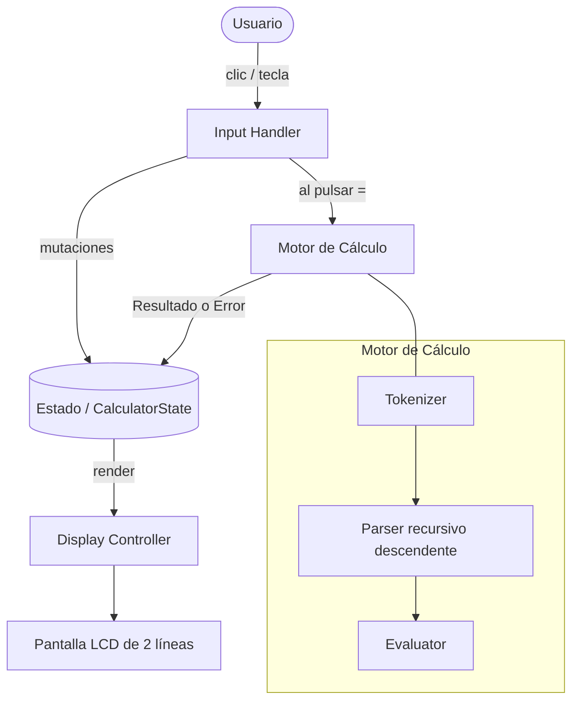

# Design Document

## Overview

Esta funcionalidad implementa una calculadora científica web que replica visualmente la Casio fx-82MS. Todo el sistema —estructura HTML, estilos CSS y lógica JavaScript— reside en un único archivo `.html` que se abre directamente en el navegador, sin dependencias externas ni procesos de compilación (Requirement 1.7).

La aplicación se organiza en dos grandes dominios:

1. **Capa de presentación e interacción**: la carcasa oscura, la Pantalla LCD de dos líneas y el teclado gris con etiquetas multifunción, más la captura de pulsaciones del usuario (Requirements 1, 2, 10).
2. **Motor de cálculo**: un pipeline puro *tokenizador → parser → evaluador* que transforma la Expresión en texto en un Resultado numérico respetando la precedencia de operadores y señalando errores de forma controlada (Requirements 3–8).

La separación entre ambos dominios es deliberada: el Motor_Cálculo es una función pura `evaluar(expresión) → Resultado | Error` sin dependencias del DOM, lo que permite verificarlo con pruebas basadas en propiedades de forma aislada. La capa de presentación observa el estado y lo refleja en la Pantalla.

### Decisiones de diseño clave

| Decisión | Alternativas consideradas | Elección y razón |
|----------|---------------------------|------------------|
| Estrategia de parsing | Shunting-yard a RPN; recursivo descendente; `eval()` nativo | **Recursivo descendente** sobre una gramática explícita. Da control total sobre precedencia, funciones unarias prefijas/postfijas y mensajes de error específicos (división por cero, dominio, paréntesis, sintaxis), algo que `eval()` no ofrece de forma segura y que shunting-yard complica para operadores postfijos como `x²`, `%` y `x⁻¹`. |
| Representación numérica | `Number` de JS (IEEE‑754 doble); bibliotecas de precisión arbitraria | **`Number` nativo**. Ofrece ~15–17 dígitos significativos, superando el mínimo de 10 exigido (Requirements 3.1–3.4, 5, 6, 7.7), sin dependencias externas (Requirement 1.7). |
| Ángulos trigonométricos | Radianes; grados | **Grados sexagesimales** por conversión explícita antes de llamar a `Math.sin/cos/tan` (Requirement 5.4). |
| Separador decimal | Coma; punto | **Punto (.)**, conforme a la Casio fx-82MS y a la interpretación numérica de JavaScript (glosario, Requirement 4.2). |

## Architecture

El sistema sigue una arquitectura por capas con flujo de datos unidireccional: la entrada del usuario muta un estado central, y el estado se renderiza en la Pantalla. El Motor_Cálculo se invoca solo al pulsar `=`.



### Capas

- **UI Layer (HTML + CSS)**: define la carcasa, la Pantalla y la rejilla de teclas. Es declarativa; no contiene lógica de cálculo.
- **Input Handler**: traduce cada pulsación (ratón o teclado físico) en una acción sobre el estado: insertar token, borrar, calcular, limpiar o ignorar (teclas decorativas).
- **Motor_Cálculo (Tokenizer + Parser + Evaluator)**: función pura que recibe la cadena de la Expresión y devuelve un Resultado o un Error tipado.
- **Display Controller**: formatea y escribe la Línea_Superior (Expresión) y la Línea_Inferior (Resultado/error), incluyendo desplazamiento horizontal y notación científica.
- **State / Ans Management**: almacena la Expresión actual, el último Resultado, el valor de Ans y el estado de error.

### Flujo de una pulsación

1. El usuario pulsa una tecla; el Input Handler recibe el evento.
2. Si es una Tecla_Decorativa, el handler no hace nada (Requirements 10.2–10.4).
3. Si es entrada de Expresión o control (DEL, AC, Ans), muta `CalculatorState`.
4. Si es `=`, invoca `evaluar(expresión)`; en éxito actualiza Resultado y Ans, en error fija el estado de error sin tocar la Expresión ni Ans.
5. El Display Controller re-renderiza ambas líneas en ≤100 ms (Requirement 2.1).

## Components and Interfaces

### Input Handler

Responsable de mapear las teclas a acciones. Interfaz conceptual:

```text
manejarTecla(tecla: DescriptorTecla, estado: CalculatorState) -> CalculatorState
```

- Teclas de dígitos, operadores, `(`, `)`, `.`, `π`, `EXP`, funciones (`sin`, `cos`, `tan`, `log`, `ln`, `√`, `∛`, `x²`, `x³`, `x⁻¹`, `^`, `%`) → insertan su token en la posición del cursor dentro de la Expresión.
- `DEL` → elimina el último carácter si la Expresión no está vacía (Requirements 9.2, 9.3).
- `AC` → vacía la Expresión y pone `0` en la Línea_Inferior (Requirement 9.1).
- `Ans` → inserta el valor numérico del último Resultado (o `0` si no existe) (Requirements 9.4, 9.5).
- `=` → dispara el Motor_Cálculo (Requirements 2.2, 2.3).
- Teclas decorativas (`SHIFT`, `ALPHA`, `MODE`, `RCL`, `nCr`, `hyp`) → acción nula (Requirement 10).

El punto decimal aplica su propia validación: se ignora si el número en curso ya contiene `.` (Requirements 4.2, 4.3).

### Motor_Cálculo: Tokenizer

Convierte la cadena de la Expresión en una lista de tokens. Interfaz:

```text
tokenizar(expresión: string) -> Token[]   // o lanza ErrorCálculo(SINTAXIS)
```

Tipos de token: `NÚMERO` (incluye decimales y notación EXP), `OPERADOR` (`+ − × ÷ ^`), `FUNCIÓN_PREFIJA` (`sin cos tan log ln √ ∛`), `OPERADOR_POSTFIJO` (`x² x³ x⁻¹ %`), `PAREN_IZQ`, `PAREN_DER`, `CONSTANTE` (`π`).

El tokenizador también interpreta la notación `EXP`: una mantisa seguida de `E` y un exponente entero, validando que exista mantisa y que el exponente sea un entero en el rango −99..99 (Requirements 8.2–8.5).

### Motor_Cálculo: Parser (recursivo descendente)

Construye un árbol de sintaxis abstracta (AST) a partir de los tokens según una gramática que codifica la precedencia. Interfaz:

```text
parsear(tokens: Token[]) -> NodoAST   // o lanza ErrorCálculo(SINTAXIS | PARÉNTESIS)
```

Gramática (de menor a mayor precedencia), donde cada nivel llama al siguiente:

```text
expresión   := términoAdit
términoAdit := términoMult ( ("+" | "−") términoMult )*
términoMult := potencia ( ("×" | "÷") potencia )*
potencia    := unarioPost ( "^" unarioPost )*          // ^ asociativo a derecha
unarioPost  := unarioPre ( "x²" | "x³" | "x⁻¹" | "%" )*
unarioPre   := ("sin"|"cos"|"tan"|"log"|"ln"|"√"|"∛") unarioPre | primario
primario    := NÚMERO | CONSTANTE | "(" expresión ")"
```

Esta estructura garantiza la precedencia estándar: `×`/`÷` antes que `+`/`−`, evaluación de igual precedencia de izquierda a derecha, y paréntesis más internos primero (Requirements 3.5, 4.1). El parser detecta paréntesis no balanceados (falta de cierre o cierre sobrante) y entrada incompleta (Requirements 3.7, 4.5).

### Motor_Cálculo: Evaluator

Recorre el AST y produce el valor numérico. Interfaz:

```text
evaluar(expresión: string) -> { ok: true, valor: number } | { ok: false, error: ErrorCálculo }
```

Reglas de evaluación relevantes:

- Funciones trigonométricas: convierten el argumento de grados a radianes (`rad = grados × π / 180`) antes de `Math.sin/cos/tan` (Requirement 5.4).
- `tan` señala error de dominio cuando `cos(argumento) = 0`, es decir 90° + 180°·k (Requirement 5.5).
- Resultados trigonométricos con valor absoluto < 1e‑10 se normalizan a `0` (Requirement 5.6).
- `log` base 10 y `ln` base e exigen argumento > 0; en caso contrario, error de dominio (Requirements 6.1–6.3).
- `√` exige argumento ≥ 0 (Requirement 7.9); `∛` admite negativos usando el signo (Requirement 7.5).
- `x⁻¹` y `÷` con operando/divisor 0 → error de división por cero (Requirements 3.6, 7.8).
- `%` divide el valor entre 100 (Requirement 4.4).
- Cualquier resultado no finito (`Infinity`/`-Infinity`) tras la operación → error de desbordamiento (Requirements 3.8, 7.10).
- `π` se sustituye por `Math.PI` (≥ 3.1415926535) (Requirement 8.1).

### Display Controller

```text
renderizar(estado: CalculatorState) -> void
```

- Línea_Superior: muestra la Expresión completa; si excede el ancho visible, desplaza horizontalmente manteniendo visibles los últimos caracteres y el cursor (Requirement 2.5).
- Línea_Inferior: muestra el Resultado, `0` cuando no hay cálculo previo (Requirements 2.4, 9.1), o el mensaje de error correspondiente (Requirements 2.3, 3.6–3.8, etc.).
- Si el Resultado no cabe en el ancho visible, lo formatea en notación científica dentro de ese ancho (Requirement 2.6).
- Formatea el Resultado con al menos 10 dígitos significativos, recortando ceros no significativos.

### State / Ans Management

Mantiene el estado central y las transiciones de Ans:

- Al evaluar con éxito, el Resultado se almacena como nuevo Ans (Requirement 9.6).
- Al fallar la evaluación, Ans conserva su valor previo (Requirement 9.7).
- Al pulsar `AC` o al iniciar la sesión, Ans vuelve a `0` (Requirement 9.5).

## Data Models

### CalculatorState

Estado único de la aplicación, observado por el Display Controller.

```text
CalculatorState {
  expresion: string        // texto de la Expresión (Línea_Superior)
  cursor: number           // posición de inserción dentro de la Expresión
  lineaInferior: string    // Resultado formateado, "0", o mensaje de error
  ans: number              // último Resultado válido; 0 si no hay ninguno
  tieneResultado: boolean  // true tras un cálculo válido desde el último AC
  estadoError: EstadoError // NINGUNO o el tipo de error vigente
}
```

### Token

```text
Token {
  tipo: NÚMERO | OPERADOR | FUNCIÓN_PREFIJA | OPERADOR_POSTFIJO
        | PAREN_IZQ | PAREN_DER | CONSTANTE
  lexema: string           // texto original
  valor?: number           // para NÚMERO y CONSTANTE
}
```

### NodoAST

```text
NodoAST =
  | { clase: "numero", valor: number }
  | { clase: "constante", nombre: "π" }
  | { clase: "binario", op: "+"|"−"|"×"|"÷"|"^", izq: NodoAST, der: NodoAST }
  | { clase: "unarioPre", fn: "sin"|"cos"|"tan"|"log"|"ln"|"√"|"∛", arg: NodoAST }
  | { clase: "unarioPost", op: "x²"|"x³"|"x⁻¹"|"%", arg: NodoAST }
```

### ErrorCálculo

Error tipado producido por el Motor_Cálculo y traducido a mensaje por el Display Controller.

```text
TipoError =
  | DIVISION_POR_CERO       // Requirements 3.6, 7.8
  | DOMINIO                 // Requirements 5.5, 6.3, 7.9
  | PARENTESIS              // Requirements 4.5
  | SINTAXIS                // Requirements 3.7, 6.4, 8.4
  | DESBORDAMIENTO          // Requirements 3.8, 7.10
  | EXPONENTE_FUERA_RANGO   // Requirements 8.5

ErrorCálculo { tipo: TipoError, mensaje: string }
```

## Correctness Properties

*A property is a characteristic or behavior that should hold true across all valid executions of a system-essentially, a formal statement about what the system should do. Properties serve as the bridge between human-readable specifications and machine-verifiable correctness guarantees.*

El Motor_Cálculo es una función pura, por lo que es un candidato idóneo para pruebas basadas en propiedades. Tras el análisis de prework y la reflexión para eliminar redundancias (la precisión de 10 dígitos se expresa como tolerancia dentro de cada propiedad numérica; 5.4 queda cubierta por las propiedades trigonométricas; 6.4, 7.10 y 8.4 se subsumen en los patrones generales de sintaxis y desbordamiento), se definen las siguientes propiedades.

### Property 1: La evaluación aritmética respeta la precedencia de operadores

*Para toda* Expresión aritmética válida compuesta por números, `+ − × ÷`, potencia `^` y paréntesis, el Resultado del Motor_Cálculo coincide, dentro de una tolerancia de 10 cifras significativas, con el valor producido por un evaluador de referencia que aplica la precedencia estándar (`×`/`÷` antes de `+`/`−`, `^` asociativo a derecha, igual precedencia de izquierda a derecha y paréntesis más internos primero).

**Validates: Requirements 3.1, 3.2, 3.3, 3.4, 3.5, 4.1**

### Property 2: El porcentaje divide entre cien

*Para todo* valor numérico `v`, evaluar la Expresión `v%` produce `v / 100` dentro de una tolerancia de 10 cifras significativas.

**Validates: Requirements 4.4**

### Property 3: Las funciones trigonométricas operan en grados

*Para todo* ángulo `θ` en el rango −999999999 a 999999999 grados, `sin(θ)`, `cos(θ)` y `tan(θ)` (cuando está definida) coinciden, dentro de una tolerancia de 10 cifras significativas, con el oráculo `Math.sin/cos/tan(θ × π / 180)`.

**Validates: Requirements 5.1, 5.2, 5.3, 5.4**

### Property 4: Los resultados trigonométricos despreciables se normalizan a cero

*Para todo* ángulo cuyo resultado trigonométrico tiene valor absoluto menor que 1e‑10, la Línea_Inferior muestra exactamente `0`.

**Validates: Requirements 5.6**

### Property 5: Los logaritmos coinciden con su oráculo

*Para todo* valor `v > 0`, `log(v)` coincide con `Math.log10(v)` y `ln(v)` coincide con `Math.log(v)`, en ambos casos dentro de una tolerancia de 10 cifras significativas.

**Validates: Requirements 6.1, 6.2**

### Property 6: Potencias y raíces coinciden con su oráculo

*Para todo* valor `v`, `x²` = `v²`, `x³` = `v³`, `√v` (para `v ≥ 0`) = `Math.sqrt(v)`, `∛v` = `Math.cbrt(v)` y, *para toda* base `b` y exponente `e`, `b^e` = `Math.pow(b, e)`, todos dentro de una tolerancia de 10 cifras significativas.

**Validates: Requirements 7.1, 7.2, 7.4, 7.5, 7.6, 7.7**

### Property 7: Raíz e inverso son operaciones inversas de potencia

*Para todo* valor `v`, `√(v²) = |v|`, `∛(v³) = v` y, *para todo* `v ≠ 0`, `(v⁻¹)⁻¹ = v`, dentro de una tolerancia de 10 cifras significativas.

**Validates: Requirements 7.1, 7.2, 7.3, 7.4, 7.5**

### Property 8: La notación exponencial equivale a M × 10^N

*Para toda* mantisa `M` y *todo* exponente entero `N` en el rango −99 a 99, evaluar `M EXP N` produce `M × 10^N` dentro de una tolerancia de 10 cifras significativas.

**Validates: Requirements 8.2, 8.3**

### Property 9: Un número contiene a lo sumo un separador decimal

*Para todo* número en construcción, insertar el Separador_Decimal `.` una o más veces deja el número con exactamente un `.` (el primero se incorpora; los siguientes se ignoran y dejan la Expresión sin cambios).

**Validates: Requirements 4.2, 4.3**

### Property 10: La división por cero produce error sin alterar la Expresión

*Para todo* numerador `n`, evaluar `n ÷ 0` (y análogamente `0⁻¹`) produce un `ErrorCálculo` de tipo `DIVISION_POR_CERO` y deja la Expresión de la Línea_Superior sin modificar.

**Validates: Requirements 3.6, 7.8**

### Property 11: Los argumentos fuera de dominio producen error de dominio

*Para todo* valor `v ≤ 0`, `log(v)` y `ln(v)` producen `DOMINIO`; *para todo* `v < 0`, `√v` produce `DOMINIO`; y *para todo* entero `k`, `tan(90 + 180·k)` produce `DOMINIO`. En todos los casos la Expresión queda sin modificar.

**Validates: Requirements 5.5, 6.3, 7.9**

### Property 12: Los paréntesis no balanceados producen error de paréntesis

*Para toda* Expresión cuyo número de paréntesis de apertura y de cierre no coincide o cuyos paréntesis están mal anidados, evaluar produce `PARENTESIS` y deja la Expresión sin modificar.

**Validates: Requirements 4.5**

### Property 13: Las entradas mal formadas producen error de sintaxis

*Para toda* cadena de Expresión sintácticamente inválida o incompleta (incluida la notación EXP sin mantisa o con mantisa/exponente no numérico, y argumentos de función mal formados), evaluar produce `SINTAXIS` de forma controlada —sin lanzar excepciones no gestionadas— y deja la Expresión sin modificar.

**Validates: Requirements 3.7, 6.4, 8.4**

### Property 14: Los resultados no representables producen desbordamiento

*Para toda* operación aritmética, potencia o raíz cuyo resultado es no finito (`±Infinity`), evaluar produce `DESBORDAMIENTO` y deja la Expresión sin modificar.

**Validates: Requirements 3.8, 7.10**

### Property 15: El exponente fuera de rango produce error específico

*Para toda* mantisa `M` y *todo* exponente entero `N` con `|N| > 99`, evaluar `M EXP N` produce `EXPONENTE_FUERA_RANGO` y deja la Expresión sin modificar.

**Validates: Requirements 8.5**

### Property 16: Un cálculo válido conserva la Expresión y almacena Ans

*Para toda* Expresión válida, pulsar `=` mantiene la Expresión idéntica en la Línea_Superior, muestra el Resultado en la Línea_Inferior y almacena ese Resultado como el nuevo valor de Ans.

**Validates: Requirements 2.2, 9.6**

### Property 17: Un cálculo fallido conserva la Expresión, la Línea_Inferior previa y Ans

*Para toda* Expresión inválida y *todo* estado con valor de Ans `a` y Línea_Inferior previa `L`, pulsar `=` deja la Expresión sin modificar, conserva `L` salvo la indicación de error y mantiene `ans = a`.

**Validates: Requirements 2.3, 9.7**

### Property 18: DEL elimina exactamente el último carácter

*Para toda* Expresión no vacía, pulsar `DEL` produce una cadena igual a la Expresión original sin su último carácter (longitud reducida en uno y prefijo de la original).

**Validates: Requirements 9.2**

### Property 19: Insertar Ans coloca el último Resultado en el cursor

*Para todo* estado con un Resultado previo `r` y un cursor en la posición `p`, pulsar `Ans` inserta la representación numérica de `r` en la posición `p` de la Expresión.

**Validates: Requirements 9.4**

### Property 20: Las teclas decorativas no tienen efecto

*Para todo* `CalculatorState` y *toda* Tecla_Decorativa (`SHIFT`, `ALPHA`, `MODE`, `RCL`, `nCr`, `hyp`), pulsar esa tecla deja el estado idéntico: no cambia la Expresión ni la Línea_Inferior y no invoca al Motor_Cálculo.

**Validates: Requirements 10.2, 10.3, 10.4**

### Property 21: La Línea_Superior refleja la Expresión introducida

*Para toda* secuencia de pulsaciones de entrada válida, el contenido de la Línea_Superior es exactamente igual a la cadena de la Expresión acumulada en el estado.

**Validates: Requirements 2.1**

### Property 22: Los resultados que exceden el ancho se muestran en notación científica

*Para todo* Resultado cuya representación decimal excede el número de caracteres visibles de la Línea_Inferior, el Display Controller produce una cadena en notación científica cuya longitud no excede ese ancho visible.

**Validates: Requirements 2.6**

## Error Handling

La gestión de errores sigue un principio único: **el Motor_Cálculo nunca lanza excepciones no controladas hacia la UI**. Todo fallo se modela como un `ErrorCálculo` tipado que el evaluador devuelve y que el Display Controller traduce a un mensaje en la Línea_Inferior, siempre conservando la Expresión en la Línea_Superior (patrón común a los Requirements 3.6–3.8, 4.5, 5.5, 6.3, 6.4, 7.8–7.10, 8.4, 8.5).

| Tipo de error | Condición que lo dispara | Requisitos | Mensaje (Línea_Inferior) |
|---------------|--------------------------|------------|--------------------------|
| `DIVISION_POR_CERO` | divisor 0 en `÷`; `x⁻¹` de 0 | 3.6, 7.8 | "Math ERROR: división por cero" |
| `DOMINIO` | `log`/`ln` de ≤0; `√` de negativo; `tan` en 90°+180°k | 5.5, 6.3, 7.9 | "Math ERROR: fuera de dominio" |
| `PARENTESIS` | paréntesis no balanceados | 4.5 | "Syntax ERROR: paréntesis" |
| `SINTAXIS` | Expresión incompleta/inválida; EXP mal formada; argumento inválido | 3.7, 6.4, 8.4 | "Syntax ERROR: expresión no válida" |
| `DESBORDAMIENTO` | resultado no finito | 3.8, 7.10 | "Math ERROR: desbordamiento" |
| `EXPONENTE_FUERA_RANGO` | exponente EXP fuera de −99..99 | 8.5 | "Syntax ERROR: exponente fuera de rango" |

### Garantías transversales ante error

- La Expresión de la Línea_Superior permanece **idéntica** a su contenido previo (Requirements 2.3, 3.6–3.8, 4.5, 5.5, 6.3, 7.8–7.10, 8.4, 8.5).
- El valor de **Ans no se modifica** cuando la evaluación falla (Requirement 9.7).
- La **Línea_Inferior previa** se conserva salvo por la sustitución por la indicación de error (Requirement 2.3).
- El orden de detección en el pipeline es: errores de tokenización/sintaxis y paréntesis (parser) → errores de dominio/división/desbordamiento (evaluador). Esto asegura que una Expresión mal formada reporte `SINTAXIS`/`PARENTESIS` antes de intentar cualquier cálculo.

## Testing Strategy

Se adopta un enfoque de pruebas dual que combina pruebas basadas en propiedades sobre el Motor_Cálculo (lógica pura) y pruebas de ejemplo/integración sobre la UI y las transiciones de estado.

### Ámbito de las pruebas basadas en propiedades (PBT)

El Motor_Cálculo (tokenizer + parser + evaluator) y las transiciones puras de estado (inserción de punto, DEL, Ans, teclas decorativas, formateo) son funciones puras con comportamiento que varía de forma significativa con la entrada y con propiedades universales claras (precedencia, operaciones inversas, condiciones de error). Por tanto, **sí es apropiado** aplicar PBT a este núcleo.

- Biblioteca de PBT: **fast-check** (JavaScript), por ser la opción estándar para el entorno de navegador/JS. No se implementará PBT desde cero.
- Cada propiedad de la sección Correctness Properties se implementa con **una única prueba basada en propiedades**.
- Cada prueba se configura con un **mínimo de 100 iteraciones**.
- Cada prueba lleva una etiqueta en comentario que referencia la propiedad del diseño, con el formato: **Feature: scientific-calculator, Property {número}: {texto de la propiedad}**.
- Las propiedades numéricas (1, 2, 3, 5, 6, 7, 8) comparan contra un **oráculo** de referencia con una tolerancia equivalente a 10 cifras significativas (comparación relativa), no igualdad exacta en punto flotante.
- Las propiedades de condición de error (10–15) generan entradas en el subdominio de fallo y verifican el `TipoError` esperado sin excepciones no controladas.
- Los generadores incluyen deliberadamente casos borde: cadenas vacías, un solo operador, números con/sin decimales, caracteres no ASCII rechazables, operandos extremos para provocar desbordamiento, ángulos en los puntos singulares de la tangente y exponentes en los límites −99/99.

### Ámbito de las pruebas que NO usan PBT

Los requisitos de renderizado y disposición de la UI no tienen una propiedad universal computable significativa y no varían con la entrada; se cubren con pruebas de ejemplo e inspección del DOM:

- **Pruebas de ejemplo / snapshot de DOM**: carcasa oscura, Pantalla de dos líneas, teclas grises con etiquetas, etiquetas secundarias multifunción, visibilidad sin scroll, presencia de las seis teclas decorativas y verificación de que todo reside en un único archivo HTML (Requirements 1.1–1.7, 10.1).
- **Pruebas de ejemplo de estado puntual**: valor inicial `0` en la Línea_Inferior, comportamiento de AC, Ans=0 sin Resultado previo, sustitución de `π` por su valor (Requirements 2.4, 8.1, 9.1, 9.5).
- **Prueba de caso borde**: `DEL` sobre Expresión vacía no modifica nada (Requirement 9.3).
- **Prueba de latencia (ejemplo)**: la Línea_Superior se actualiza en ≤100 ms tras una pulsación (Requirement 2.1, complemento de la Property 21).
- **Prueba de ejemplo de desplazamiento**: una Expresión larga mantiene visibles los últimos caracteres y el cursor (Requirement 2.5).

### Mapa de cobertura resumido

- Lógica del motor y estado puro → Properties 1–22 (PBT, fast-check, ≥100 iteraciones).
- Renderizado/disposición/empaquetado → pruebas de ejemplo y snapshot de DOM.
- Estados puntuales y casos borde → pruebas de ejemplo e integración ligera.

Ambos tipos de prueba son complementarios: las de ejemplo fijan comportamientos concretos y la apariencia; las de propiedades verifican la corrección general del cálculo sobre un amplio espacio de entradas.
